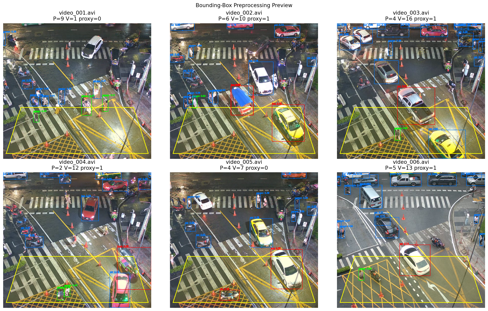
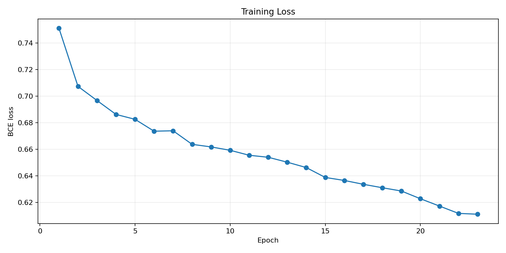
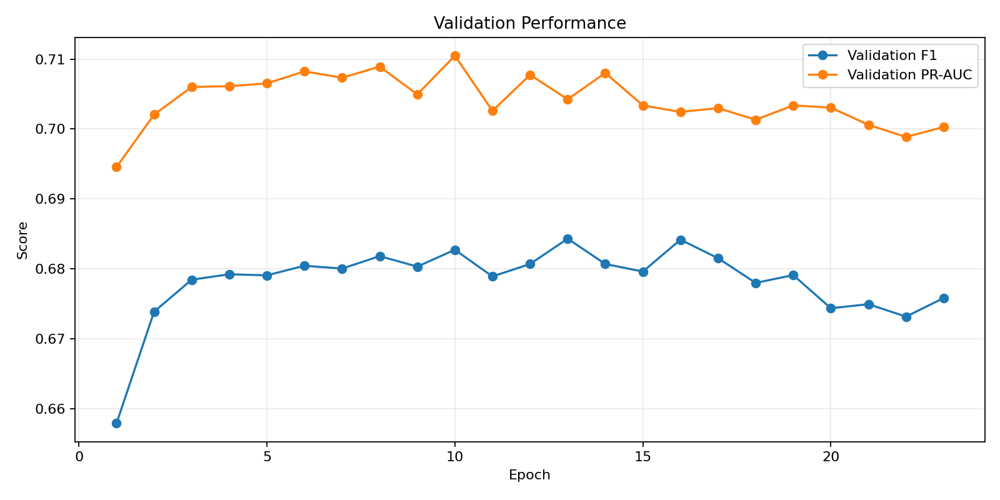
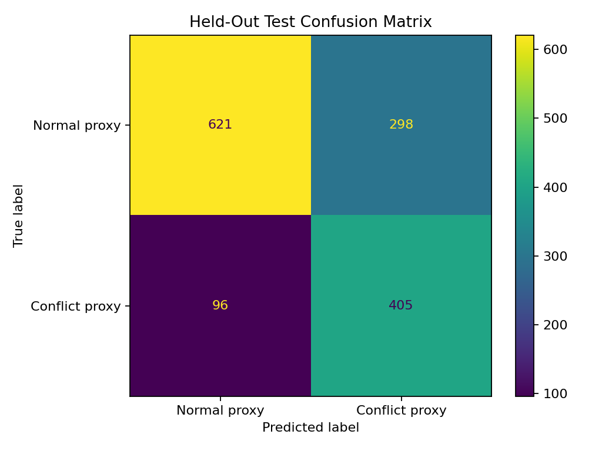
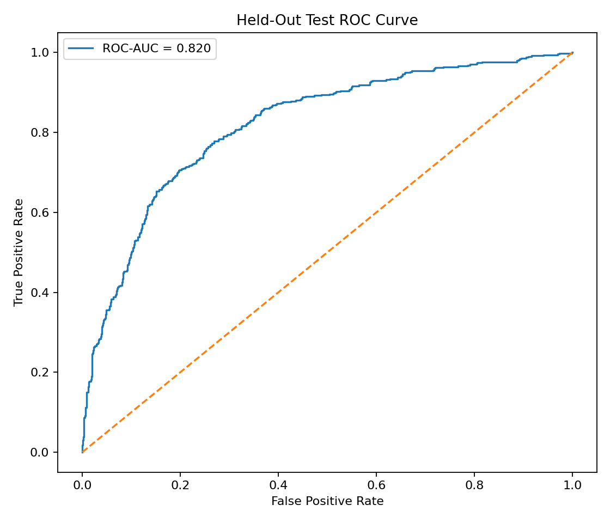
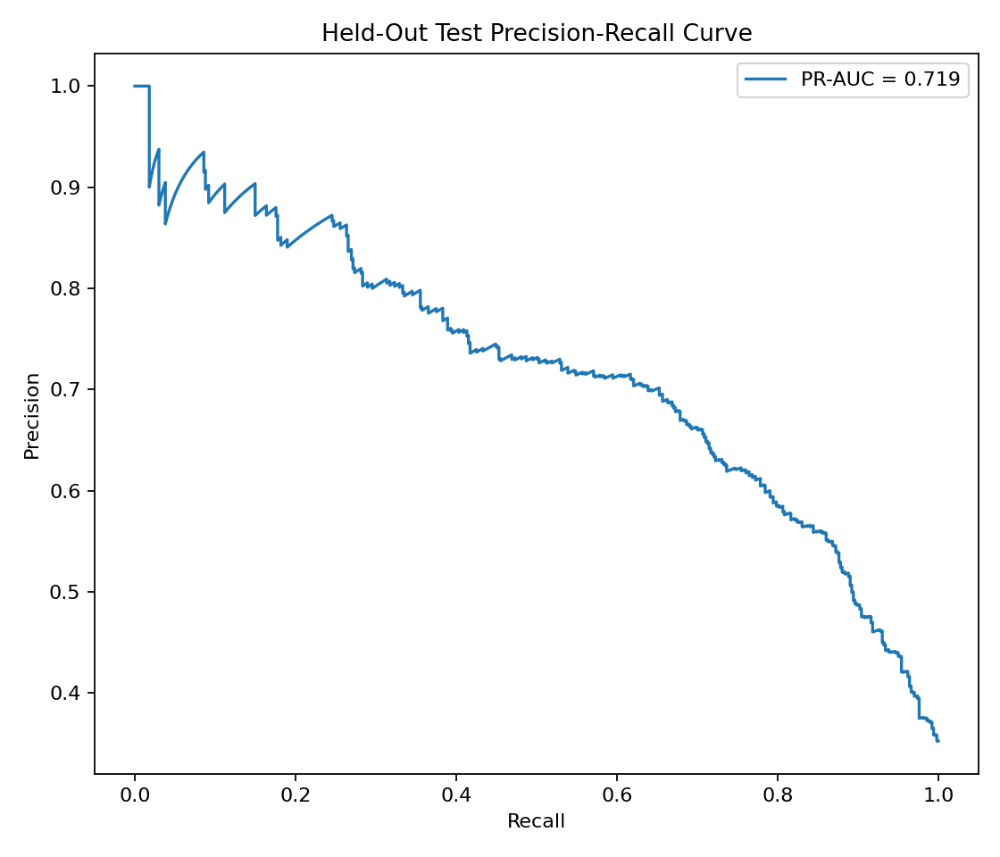
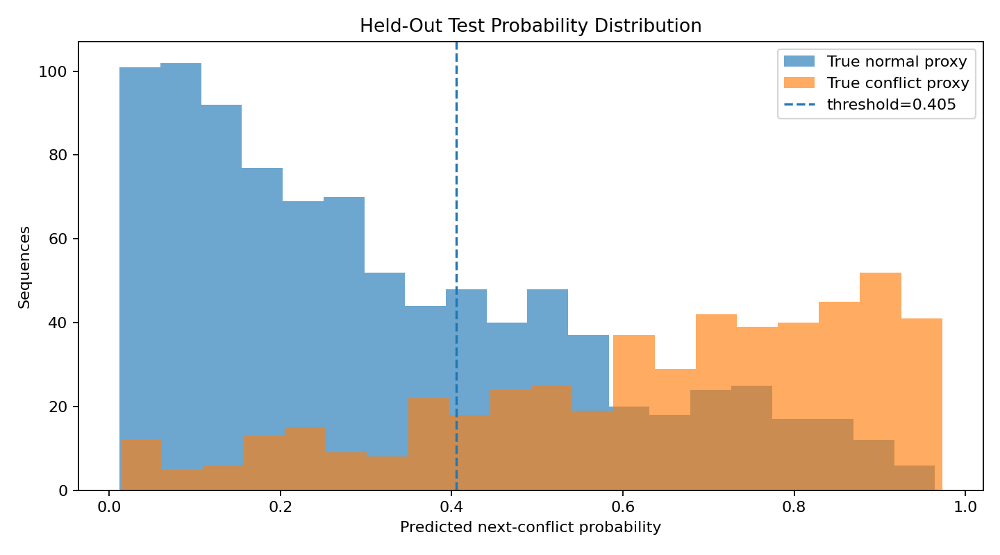
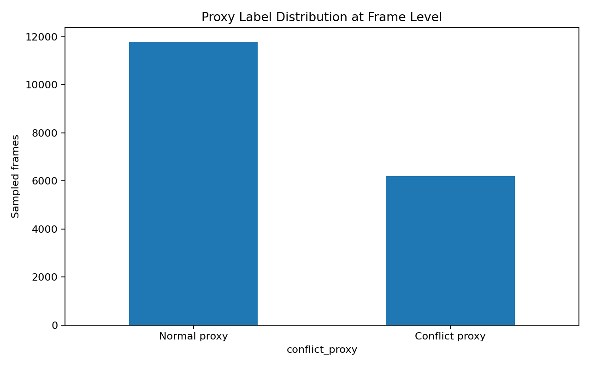

# 🚸 Crosswalk Safety v4

<p align="center">
  <strong>Weakly supervised temporal safety-conflict screening from traffic videos</strong>
</p>

<p align="center">
  YOLO11n bounding-box preprocessing → 21 spatial/motion features → Temporal Conv1D + BiLSTM
</p>

<p align="center">
  
  
  
  
  
</p>

---

## Overview

**Crosswalk Safety v4** is a computer-vision portfolio project for screening temporal pedestrian–vehicle conflict patterns in traffic videos.

The system does not train an object detector from scratch. Instead, a **COCO-pretrained YOLO11n** model is used as the bounding-box preprocessing stage. The detected person and vehicle boxes are transformed into compact spatial and motion features, then a **custom-trained Temporal Conv1D + BiLSTM** predicts whether the **next sampled frame** will match the project's conflict proxy.

The project is intentionally framed as a **safety-screening MVP**, not as a validated traffic-violation detector.

> **Important:** reported metrics measure agreement with a weak/pseudo conflict label, not real-world traffic-violation accuracy.

---

## 8% Portfolio Milestone

This repository represents the **8% learning milestone** in an ongoing portfolio growth journey.

The percentage indicates learning progress, not project count and not production-readiness.

---

## Problem

Static object detection can tell us that pedestrians and vehicles are present, but it does not directly model how their relationship evolves over time.

Crosswalk Safety explores a lightweight temporal pipeline that asks:

> Given the previous traffic state, can a model predict whether the next sampled frame will contain a pedestrian–vehicle conflict proxy inside a configured safety zone?

---

## System Architecture

```text
Traffic video
    ↓
Frame sampling every 2 seconds
    ↓
YOLO11n pretrained on COCO
    ↓
Bounding-box preprocessing
    ↓
Person + vehicle spatial descriptors
    ↓
21 engineered spatial / occupancy / motion features
    ↓
8-step temporal history (16 seconds)
    ↓
Temporal Conv1D
    ↓
BiLSTM
    ↓
Binary classifier
    ↓
Next-sample conflict probability (2-second horizon)
```

### Object classes used

The YOLO preprocessing stage only keeps:

- person
- car
- motorcycle
- bus
- truck

---

## Bounding-Box Preprocessing

The custom temporal model does **not** receive raw pixels.

For each sampled frame, the YOLO detections are converted into features such as:

- person count;
- vehicle count;
- pedestrians inside the configured ROI;
- vehicles inside the configured ROI;
- normalized person center position;
- normalized vehicle center position;
- normalized bounding-box area;
- minimum person–vehicle distance;
- mean person–vehicle distance;
- first-order temporal differences for selected features.

A total of **21 features** are used by the temporal classifier.

<p align="center">
  
</p>

---

## Weak / Pseudo Target

The source videos do not contain manually validated traffic-conflict labels.

The training target is therefore a weak proxy:

```text
conflict_proxy =
    pedestrian_in_ROI > 0
    AND
    vehicle_in_ROI > 0
```

The temporal model is trained to predict this proxy on the **next sampled frame**, using only the preceding temporal history.

This avoids directly passing the current target rule into the model input, but it still means the supervision is weak rather than human-validated.

---

## Dataset Processing

The final v4 experiment processed:

| Item | Value |
|---|---:|
| Videos | 120 |
| Sampled frames | 18,000 |
| Sampling interval | 2 seconds |
| Features | 21 |
| Sequence length | 8 sampled frames |
| Temporal history | 16 seconds |
| Prediction horizon | 2 seconds |

### Video-level split

The split is performed by **video**, not by individual frame or sequence, to reduce temporal leakage.

| Split | Videos | Sequences |
|---|---:|---:|
| Train | 91 | 12,922 |
| Validation | 19 | 2,698 |
| Test | 10 | 1,420 |

Detailed artifacts are available in:

- [Video audit](reports/video_audit.csv)
- [Video split](reports/video_split.csv)
- [Frame features](reports/frame_features.csv)
- [Frame features with motion](reports/frame_features_with_motion.csv)
- [Training history](reports/training_history.csv)
- [Held-out test predictions](reports/test_predictions.csv)
- [Final summary](reports/final_summary.json)
- [Test metrics](reports/test_metrics.json)

---

## Model

The custom model combines a temporal convolutional frontend with a bidirectional recurrent layer:

```text
Input: [batch, 8, 21]
        ↓
Conv1D
        ↓
BatchNorm + GELU + Dropout
        ↓
Conv1D
        ↓
BatchNorm + GELU
        ↓
BiLSTM
        ↓
LayerNorm
        ↓
Dense
        ↓
Binary logit
```

The trained artifacts are stored in:

```text
models/
├── crosswalk_temporal_cnn_bilstm_v4.pt
├── feature_mean.npy
└── feature_scale.npy
```

The NumPy files preserve the training feature normalization statistics so local inference uses the same preprocessing scale.

---

## Held-Out Test Results

The final model uses a validation-selected decision threshold of **0.405**.

| Metric | Held-out Test |
|---|---:|
| Accuracy | **72.25%** |
| Precision | **57.61%** |
| Recall | **80.84%** |
| F1-score | **67.28%** |
| ROC-AUC | **82.02%** |
| PR-AUC | **71.88%** |

Best validation F1: **68.43%**

### Interpretation

The model prioritizes sensitivity more than precision. A recall of **80.84%** means it captures a relatively high proportion of the proxy-positive test sequences, while the lower precision indicates that false-positive screening alerts remain an important limitation.

These values must **not** be interpreted as traffic-violation detection accuracy.

---

## Evaluation Visuals

### Training Loss

<p align="center">
  
</p>

### Validation Metrics

<p align="center">
  
</p>

### Confusion Matrix

<p align="center">
  
</p>

### ROC Curve

<p align="center">
  
</p>

### Precision–Recall Curve

<p align="center">
  
</p>

### Probability Distribution

<p align="center">
  
</p>

### Proxy Label Distribution

<p align="center">
  
</p>

---

## Streamlit Application

The local Streamlit app supports:

- traffic-video upload;
- YOLO11n person / vehicle preprocessing;
- temporal feature extraction;
- 8-step history buffering;
- trained Conv1D + BiLSTM inference;
- next-sample conflict probability;
- temporal probability chart;
- sampled-frame diagnostics;
- CSV export;
- annotated-video rendering.

Example diagnostic output from a local test clip:

```text
sampled frames         : 30
temporal predictions   : 22
predicted conflict rate: 9.1%
agreement vs proxy     : 86.4%
```

The last value is only a diagnostic for that uploaded clip and is **not** a replacement for the held-out test benchmark.

---

## Running Locally

```bash
git clone https://github.com/MENSTRUE/crosswalk-safety.git
cd crosswalk-safety
```

Windows PowerShell:

```powershell
python -m venv .venv
.\.venv\Scripts\Activate.ps1
pip install -r requirements.txt
streamlit run app/streamlit_app.py
```

### Video preview note

The inference pipeline samples frames every 2 seconds for model efficiency. The annotated preview therefore represents sampled temporal states rather than full-frame-rate object inference.

---

## Repository Structure

```text
crosswalk-safety/
├── app/
│   └── streamlit_app.py
├── assets/
│   └── previews/
├── models/
│   ├── crosswalk_temporal_cnn_bilstm_v4.pt
│   ├── feature_mean.npy
│   └── feature_scale.npy
├── notebooks/
├── reports/
├── src/
│   ├── __init__.py
│   ├── detector.py
│   ├── feature_extractor.py
│   ├── pipeline.py
│   ├── roi.py
│   ├── temporal_model.py
│   └── visualize.py
├── AGENTS.md
├── LICENSE
├── README.md
└── requirements.txt
```

---

## Key Design Decisions

### Why not retrain YOLO11n?

YOLO11n is used as a pretrained object-localization stage because the project focus is not generic person/car detection. The custom learning component focuses on **temporal interaction patterns derived from bounding boxes**.

### Why predict the next sampled frame?

Predicting the next sampled state makes the temporal model consume only historical features rather than directly seeing the rule used to define the current target.

### Why video-level splitting?

Neighboring frames from one traffic video are highly correlated. Video-level separation gives a more meaningful held-out evaluation than randomly mixing frames from the same video across train and test sets.

---

## Limitations

1. **Weak supervision** — labels are generated from a rule-based ROI proxy rather than manual traffic-safety annotation.
2. **ROI dependency** — the safety zone is configured as a fixed normalized polygon rather than a learned crosswalk segmentation mask.
3. **Sampling interval** — inference runs every 2 seconds, so short events between samples may be missed.
4. **Detection dependency** — temporal features depend on the quality of YOLO11n detections.
5. **No legal interpretation** — predicted conflict does not mean a legal traffic violation occurred.
6. **Limited external validation** — the current evaluation is tied to the available video collection and proxy target definition.

---

## Future Work

Potential extensions include:

- manual event-level conflict annotation;
- automatic crosswalk segmentation;
- object tracking and trajectory features;
- time-to-collision estimation;
- denser sampling or adaptive sampling;
- calibrated temporal probabilities;
- comparison against classical ML baselines;
- external-city validation;
- real-time GPU inference.

---

## Tech Stack

- Python
- PyTorch
- Ultralytics YOLO11n
- OpenCV
- NumPy
- Pandas
- scikit-learn
- Matplotlib
- Streamlit
- FFmpeg

---

## Reproducibility

The repository includes preprocessing notebooks, trained temporal model artifacts, feature normalization statistics, video-level split reports, training history, test prediction CSVs, final metrics JSON, and generated evaluation plots.

This makes the portfolio result auditable rather than presenting only a final score.

---

## Scope Statement

Crosswalk Safety v4 should be described as:

> **A weakly supervised temporal safety-conflict screening system that uses YOLO11n bounding-box preprocessing and a custom Conv1D + BiLSTM classifier to predict the next sampled conflict proxy.**

It should **not** be described as:

- a validated traffic-violation detector;
- a trained crosswalk detector;
- a zebra-crossing segmentation model;
- a system with validated real-world violation accuracy.

---

## License

This repository is released under the [MIT License](LICENSE).

---

## Author

**Wafa Bila Syaefurokhman**

GitHub: [@MENSTRUE](https://github.com/MENSTRUE)

---

<p align="center">
  <strong>Build → measure → document → improve.</strong>
</p>
